<!-- ===================== HERO ===================== -->
<picture>
  <source media="(prefers-color-scheme: dark)" srcset="./assets/hero-dark.svg">
  
</picture>

  

  
  
  

<!-- ===================== PROJECTS (turn on later) =====================
To add projects: delete this opening comment line (the PROJECTS one)
and the closing comment marker at the bottom of this block, then
replace REPO-NAME-1 / REPO-NAME-2 with your repo names.

<picture>
  <source media="(prefers-color-scheme: dark)" srcset="./assets/title-projects-dark.svg">
  
</picture>

  <a href="https://github.com/Yusra-Khan532/REPO-NAME-1">
    <picture>
      <source media="(prefers-color-scheme: dark)" srcset="https://github-readme-stats.vercel.app/api/pin/?username=Yusra-Khan532&repo=REPO-NAME-1&hide_border=true&bg_color=111f3a&title_color=5eead4&icon_color=38bdf8&text_color=e6edf7">
      
    </picture>
  </a>
  <a href="https://github.com/Yusra-Khan532/REPO-NAME-2">
    <picture>
      <source media="(prefers-color-scheme: dark)" srcset="https://github-readme-stats.vercel.app/api/pin/?username=Yusra-Khan532&repo=REPO-NAME-2&hide_border=true&bg_color=111f3a&title_color=5eead4&icon_color=38bdf8&text_color=e6edf7">
      
    </picture>
  </a>

<picture>
  <source media="(prefers-color-scheme: dark)" srcset="./assets/divider-dark.svg">
  
</picture>
-->

<!-- ===================== GITHUB ACTIVITY ===================== -->
<picture>
  <source media="(prefers-color-scheme: dark)" srcset="./assets/activity-dark.svg">
  
</picture>

<picture>
  <source media="(prefers-color-scheme: dark)" srcset="./assets/divider-dark.svg">
  
</picture>

<!-- ===================== ABOUT ===================== -->
<picture>
  <source media="(prefers-color-scheme: dark)" srcset="./assets/title-about-dark.svg">
  
</picture>

<picture>
  <source media="(prefers-color-scheme: dark)" srcset="./assets/about-dark.svg">
  
</picture>

<picture>
  <source media="(prefers-color-scheme: dark)" srcset="./assets/divider-dark.svg">
  
</picture>

<!-- ===================== STACK ===================== -->
<picture>
  <source media="(prefers-color-scheme: dark)" srcset="./assets/title-stack-dark.svg">
  
</picture>

<picture>
  <source media="(prefers-color-scheme: dark)" srcset="./assets/stack-dark.svg">
  
</picture>

  

<picture>
  <source media="(prefers-color-scheme: dark)" srcset="./assets/divider-dark.svg">
  
</picture>

<!-- ===================== STATS ===================== -->
<picture>
  <source media="(prefers-color-scheme: dark)" srcset="./assets/title-stats-dark.svg">
  
</picture>

  <picture>
    <source media="(prefers-color-scheme: dark)" srcset="https://github-readme-stats.vercel.app/api?username=Yusra-Khan532&show_icons=true&hide_border=true&bg_color=111f3a&title_color=5eead4&icon_color=38bdf8&text_color=e6edf7&rank_icon=github">
    
  </picture>

<picture>
  <source media="(prefers-color-scheme: dark)" srcset="./assets/divider-dark.svg">
  
</picture>

<!-- ===================== CONNECT ===================== -->
<picture>
  <source media="(prefers-color-scheme: dark)" srcset="./assets/title-connect-dark.svg">
  
</picture>

  
  
  

